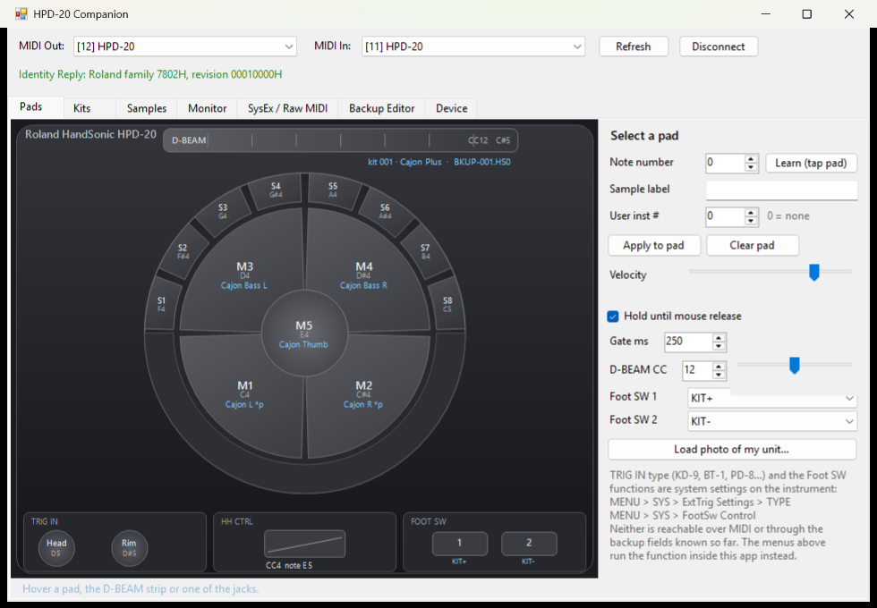
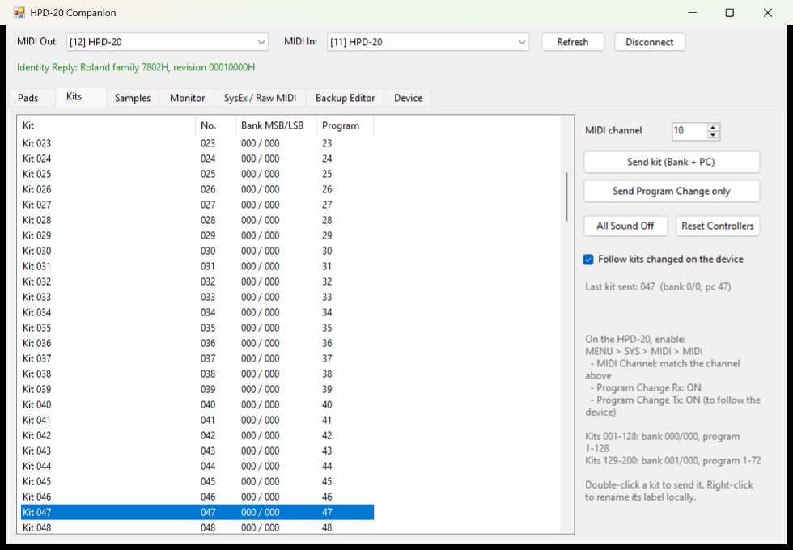
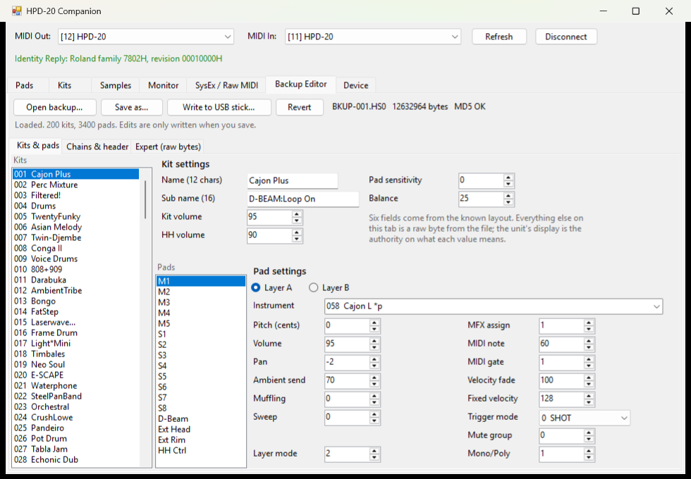

# Roland HPD-20 Software Companion for Windows 10+

**A Windows companion app for the Roland HandSonic HPD-20.** Play the pads from your screen, change
kits over MIDI, convert samples to the import format, mirror a real backup onto the pad display, and
edit the complete memory image offline before writing it back to a USB stick.



A single 230 KB executable. No installer, no runtime to download, no third-party libraries: it builds
with the C# compiler that already ships with Windows. Verified against a real HPD-20 and against
Roland's factory backup image.

---

## Why this exists

The HPD-20 speaks plenty of MIDI, but Roland never published a way to edit its sounds remotely — there
is no SysEx parameter table:

> "The System Exclusive Messages received by this instrument are Universal Non-Realtime System
> Exclusive messages." — *HPD-20 MIDI Implementation*, p. 2

So the app does the two things that *are* possible, and is explicit about everything else:

| | Over MIDI | Over a USB backup file |
|---|---|---|
| Select kits | ✅ bank select + program change | ✅ |
| Trigger pads, D-BEAM, TRIG IN, HH CTRL | ✅ note on/off | — |
| Kit names, pad instruments, volume, pan, pitch, tuning | ❌ | ✅ |
| Chain names | ❌ | ✅ |
| TRIG IN pad type, foot-switch functions | ❌ see [note](#what-cannot-be-changed-from-here) | ❌ not identified |

---

## Status

Exercised against a connected HPD-20 (identity reply, note send, kit change, clean disconnect) and
against two real backup images — Roland's factory image and a user image made after changing settings
on the unit. **175 automated checks across 9 suites, 0 failures.**

What the device itself reported:

```
ports        output [12] HPD-20   input [11] HPD-20
identity     F0 7E 10 06 02 41 78 02 00 00 00 01 00 00 F7
             Roland (41), device id 10, family 7802, member 0000, rev 00 01 00 00
teardown     2 ms
```

---

## Features

**Pads** — an interactive top view of the real surface: M5 centre, M1/M2 nearest you, M3/M4 above,
S1–S8 across the top half of the rim, D-BEAM along the top edge, and TRIG IN / HH CTRL / FOOT SW along
the bottom. Every element is clickable and the tile shows its current assignment:

- each pad shows its MIDI note **and the instrument name from the loaded backup**
- the D-BEAM strip shows its **controller number** (CC12 by default) and note
- HH CTRL shows **CC4** and its note; TRIG IN shows head and rim notes
- the foot switches show the function they will run
- a caption states which kit and which backup file the display is mirroring

Loading a backup therefore turns the Pads tab into a live read-out of that kit: pick a kit in the
Backup Editor and the tiles change with it.



**Kits** — all 200 kits with the documented bank/program mapping, kit follow, All Sound Off, Reset
Controllers, and local kit labels.

**Samples** — batch resample any WAV (PCM 8/16/24/32-bit or float, any rate, mono or stereo) to the
import format: 44.1 kHz, 16-bit, 6:00 maximum. Windowed-sinc rate conversion, optional mono downmix,
normalise, silence trim, edge fades. Then write a pack to a USB stick — root copies in ASCII names for
the unit, an organised folder for you.


**Backup Editor** — opens `BKUP-nnn.HS0` images: all 200 kits and 3,400 pads (two layers, 850 named
instruments), the 15 chain names, and the header. Saves recompute the MD5 trailer, and an unedited file
round-trips byte for byte.



**Backup diff** — `--backupdiff a.HS0 b.HS0` reports exactly what changed between two images: field by
field for kits and pads, then every differing byte grouped into ranges with the region named. This is
how you find out what a change on the instrument actually wrote.

**Expert (raw bytes)** — every byte reachable by offset, with the region named.

**Monitor / SysEx / Device** — decoded MIDI monitor, raw SysEx console with a Roland checksum helper,
and Identity Reply parsing.

**Hover help everywhere** — every control on every tab explains itself: what you are hovering over,
what it does, and how to use it. On the Pads tab the line under the surface additionally describes the
exact element under the mouse, its note or controller number and what a click will do.

---

## What cannot be changed from here

Two settings live on the instrument with no MIDI message and no identified backup field:

| Setting | Where |
|---|---|
| TRIG IN pad type (KD-7, KD-9, BT-1, PD-8, PDX-6, PDX-8, CY-5, CY-8, CY-12C) | `MENU → SYS → ExtTrig Settings → TYPE` |
| Foot switch 1/2 function | `MENU → SYS → FootSw Control` |

The app mirrors the foot-switch function list and runs the MIDI-addressable ones (KIT+/KIT−, All Sound
Off). Comparing two backups does show *where* such settings live as bytes, but the meaning of those
bytes is not confirmed, so the app does not offer to change them.

---

## Requirements

- Windows 10 or 11 (x64). .NET Framework 4.x is part of Windows.
- For MIDI: the Roland USB driver and the HPD-20 on USB.
- For sample import: a USB flash drive.
- Nothing else — no .NET SDK, no Visual Studio, no Python.

## Build

```powershell
git clone <your-repo-url>
cd hpd20-companion
.\build.ps1
```

Produces `dist\HPD20Companion.exe`. Add `-Test` to run every suite, optionally with
`-BackupPath <file>` to include a real-backup check.

## Quick start

1. Connect the HPD-20, install the Roland driver, start `HPD20Companion.exe`.
2. Pick the MIDI ports (anything named `HPD`/`HANDSONIC` is picked automatically) and press
   **Connect**. The Device tab filling in confirms both directions work.
3. On the instrument: `MENU → SYS → MIDI → MIDI` — **MIDI Channel** matching the app,
   **Program Change Rx/Tx = ON**, **Control Change Rx = ON**.
4. Play the pads from the screen, switch kits on the Kits tab, or open a backup to see that kit's pads.

Full walkthroughs are in **[USAGE.md](USAGE.md)**.

## Self-tests

```powershell
.\dist\HPD20Companion.exe --padtest      test-results\padtest.txt      # 30 checks: pad placement, jacks, hit-testing
.\dist\HPD20Companion.exe --hwtest       test-results\hwtest.txt       # 11 checks: identity, note, kit change, teardown
.\dist\HPD20Companion.exe --selftest     test-results\selftest.txt     # 19 checks: kit mapping, checksum, SysEx round trip
.\dist\HPD20Companion.exe --uitest       test-results\uitest.txt       # 14 checks: UI path + backup-to-pads mirroring
.\dist\HPD20Companion.exe --audiotest    test-results\audiotest.txt    # 16 checks: formats, resampling, trim, truncation
.\dist\HPD20Companion.exe --usbtest      test-results\usbtest.txt      # 15 checks: root layout, naming, archive
.\dist\HPD20Companion.exe --backuptest   test-results\backuptest.txt   # 40 checks: offsets, MD5, field round trip
.\dist\HPD20Companion.exe --backupcheck  <file>.HS0 test-results\backupcheck.txt       # 15 checks on a real image
.\dist\HPD20Companion.exe --backupdiff   <a>.HS0 <b>.HS0 test-results\backupdiff.txt   # what changed between two images
```

Recorded output is committed under `test-results/`. Set `HPD20_TEST_BACKUP` to a backup path before
`--uitest` to include the pad-mirroring checks.

## Project layout

```
src/            application sources
tests/          test suites and the backup diff tool, compiled into the same executable
screenshots/    images used by this README
test-results/   recorded output of every suite
tools/          screenshot helper used while building the docs
build.ps1       one-command build (+ optional tests)
```

## Limitations, honestly

- **No SysEx parameter editing exists on this device.**
- **The backup format is reverse engineered**, not documented by Roland. The layout comes from the
  [`hpd20`](https://github.com/scjurgen/hpd-20) project and is validated against two real images: MD5
  trailers, named kits, factory note numbers, chain names, and a byte-identical load→save round trip.
  An *edited* file has not been loaded into an instrument. **Keep your original backup** — `Load
  Backup` erases every setting on the unit.
- Pad instrument names and notes on the Pads tab come from the loaded backup; the CC numbers for
  D-BEAM and HH CTRL are what the app sends, not a value read back from the unit.
- Kit names are not transmitted over MIDI, so Kits-tab labels are local.
- The hardware suite proves the link, the identity reply, note sending and a clean disconnect.
  Confirming that a struck pad lights up still needs a human to hit it.

## Credits

- [Roland HPD-20 MIDI Implementation](https://static.roland.com/assets/media/pdf/HPD-20_MI.pdf) and
  [Owner's Manual](https://static.roland.com/assets/media/pdf/HPD-20_OM.pdf) — the authoritative
  sources for everything done over MIDI.
- [Roland's default note map](https://support.roland.com/hc/en-us/articles/210712223-HandSonic-HPD-20-Default-MIDI-Note-Number-Map).
- [`scjurgen/hpd-20`](https://github.com/scjurgen/hpd-20) (MIT) — the reverse-engineered backup layout
  and the instrument-name table.
- Pad geometry measured from the printed label positions on p. 14 of the owner's manual.

## Licence

MIT — see [LICENSE](LICENSE).

Roland, HandSonic, D-BEAM and V-Drums are trademarks of Roland Corporation. This project is
unaffiliated with and not endorsed by Roland. Instrument and kit names originate from the HPD-20's own
documentation and are used descriptively.
