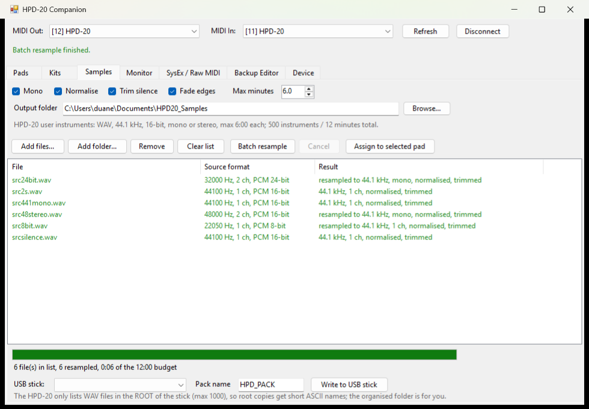
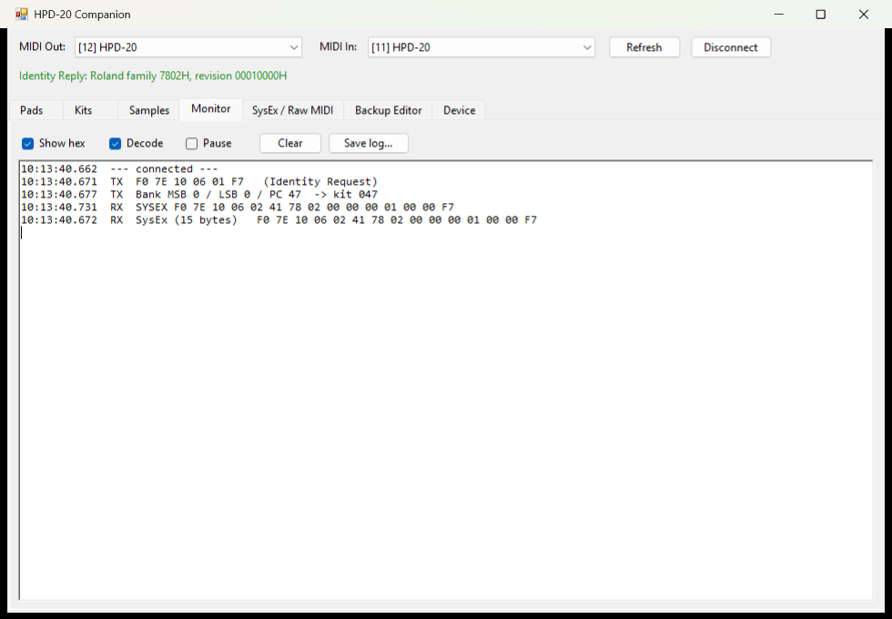

# HPD-20 Companion

[](https://github.com/BeatrootRissole/Roland-HPD-20-Software-Companion/actions/workflows/build.yml)
[](https://github.com/BeatrootRissole/Roland-HPD-20-Software-Companion/releases)
[](LICENSE)

**A companion app for the Roland HandSonic HPD-20.** It shows the instrument on your screen, plays the
pads from your mouse, switches kits over the USB cable, and prepares and converts samples so the unit
can import them. It runs on Windows.

It is one small program with no installer. Nothing is written to the instrument unless you ask it to.

## What it does, in plain words

- **Shows the whole surface on screen** — every pad, the D-BEAM, the hi-hat pedal, the trigger input and
  both foot switches. Click one and the instrument plays it.
- **Changes kits** from a list, instead of turning the dial.
- **Prepares samples** — takes almost any audio file, converts it to the one format the HPD-20 accepts,
  and puts it on a USB stick ready to import.
- **Cuts samples up** — a built-in waveform editor for trimming, slicing loops into pieces, joining
  pieces back together, and listening to the result before you commit to it.
- **Edits the instrument's settings off-line** — it can open the HPD-20's own backup file, let you change
  kit and pad settings on your PC, and write the file back to the stick.

---

## Getting started on Windows

**1. Download the app.** Go to
[Releases](https://github.com/BeatrootRissole/Roland-HPD-20-Software-Companion/releases/latest) and
download `HPD20Companion.exe`.

**2. Run it.** Double-click the file. There is nothing to install and no administrator rights needed.
Windows may warn that the file came from the internet — choose **More info → Run anyway**.

**3. Plug the HPD-20 into the PC with a USB cable**, and switch it on. Windows normally recognises it on
its own. If the app says no ports were found, install the
[Roland driver](https://www.roland.com/global/support/by_product/handsonic_hpd-20/updates_drivers/)
and try again.

**4. Connect.** Pick the two entries that mention `HPD-20` in the boxes at the top (they are usually
chosen for you), then press **Connect**.

**5. Make the instrument listen.** On the HPD-20 itself, go to `MENU → SYS → MIDI → MIDI` and check:

| Setting | Value |
|---|---|
| MIDI Channel | must match the channel shown in the app |
| Program Change Rx / Tx | ON |
| Control Change Rx | ON |

**6. Try it.** Click a pad on screen — it should sound. Pick a different kit on the **Kits** tab and the
instrument should change with it.

### If something doesn't work

| What you see | What to try |
|---|---|
| No ports in the list | Replug the USB cable, press **Refresh**, install the Roland driver |
| Connected, but clicking a pad is silent | Check **Control Change Rx** and the MIDI channel above; turn the kit volume up on the unit |
| The instrument changes kit but the app's kit list doesn't follow | Set **Program Change Tx** to ON |
| Sample is refused by the instrument | It must be a WAV, 44.1 kHz, 16-bit, and it must sit in the **root** of the stick, not a folder |

---

## Getting started on macOS and Linux

The full app cannot run there — it is built on parts of Windows that do not exist on other systems, and
it talks to the instrument through Windows' own MIDI and audio services.

**You can still convert samples on macOS and Linux.** The conversion engine is a small command-line tool
that builds anywhere the .NET SDK is installed:

```bash
# once
dotnet build cli

# then
hpd20cli convert mysample.aiff --out converted --mono
hpd20cli info mysample.flac
```

That produces the WAV files the HPD-20 accepts, ready to be copied to the stick. Everything else — the
pad display, kits, the waveform editor, the backup editor — needs the Windows version.

If you use a Mac or Linux machine and want the whole app, run it on a Windows PC or in a Windows virtual
machine.

---

## Putting samples on the instrument

This is the part most people want, so here it is end to end.

1. **Convert.** Open the **Samples** tab, use the file browser on the left to find your audio, press
   **Add**, then **Batch resample**. Files of any normal format and sample rate are converted to what the
   HPD-20 needs.
2. **Write to a USB stick.** Choose the stick in the drop-down and press **Write to USB stick**. The
   files are copied to the root of the stick with short names, because the instrument only lists files
   it finds there (1,000 maximum).
3. **Import on the unit.** Plug the stick into the HPD-20, then `MENU → USER INST → IMPORT`, choose a
   sample, and save it into one of the 500 user instrument slots.

The unit allows 6 minutes per sample and 12 minutes in total; the app warns you when you go over.



---

## What each tab does

**Pads** — the instrument's surface drawn to scale. Pads show their note number, the D-BEAM and hi-hat
pedal show their controller number, and the foot switches show what they will do. Click to play. Load a
backup file and the pads also show which instrument each one is playing.


**Kits** — all 200 kits, selectable from a list. `All Sound Off` and `Reset Controllers` are there for
when a note sticks.


**Samples** — a file browser, a conversion queue, and the waveform editor in one window.



**Waveform editor** — the lower half of the Samples tab. Drag across the waveform to select, then keep
it, delete it, fade it, or copy and paste it elsewhere. **Slice** cuts a file into equal pieces, and
**Auto-slice** cuts at every gap of silence, which turns a recorded loop into separate hits. **Play**
auditions the result and **Send to samples** puts the pieces back in the conversion queue. Every edit can
be undone.

**Backup Editor** — opens the HPD-20's backup file (`BKUP-001.HS0` from the stick) so you can change kit
names, pad instruments, volumes, tuning and the chain names on your PC. **Keep a copy of the original
file**: loading a backup into the instrument replaces everything on it.


**Monitor / SysEx / Device** — a readable log of the MIDI going back and forth, plus a raw SysEx console
and the instrument's identity reply. Mostly for working out why something is not responding.

---

## Things the app cannot do, and why

Roland implemented only a small part of MIDI on this instrument, and published no way to edit its
settings remotely:

> "The System Exclusive Messages received by this instrument are Universal Non-Realtime System Exclusive
> messages." — *HPD-20 MIDI Implementation*, p. 2

So there is **no way to change pad sounds over the USB cable**, by this app or any other. What can be done
over the cable is: choose kits, play notes, move the hi-hat controller, and send control changes. Anything
deeper has to go through the backup file on a USB stick, which is what the Backup Editor is for.

Two settings live only on the instrument and appear in no message at all: the **TRIG IN pad type** and the
**foot switch functions**. The app mirrors the foot switch list but cannot read or change what the unit is
set to.

---

# Technical detail

Everything below is for people who want to build it, test it or modify it.

## How it talks to the instrument

MIDI over USB, through Windows' `winmm` API directly — no driver libraries, no third-party packages.

```
ports        output [12] HPD-20   input [11] HPD-20
identity     F0 7E 10 06 02 41 78 02 00 00 00 01 00 00 F7
             Roland (41), device id 10, family 7802, member 0000, rev 00 01 00 00
```

Kit selection uses bank select plus program change: `000/000` reaches kits 001–128, `001/000` reaches
129–200. Factory note numbers are M1=60 … S8=72, D-BEAM=73, Ext Head=74, Ext Rim=75, HH=76.

## Requirements

- Windows 10 or 11 (x64) for the GUI. .NET Framework 4.x ships with Windows.
- For MIDI: the Roland USB driver.
- For sample import: a USB flash drive.
- Building needs nothing extra — the C# compiler in `%WINDIR%\Microsoft.NET\Framework64\v4.0.30319`
  is used directly. No SDK, no NuGet, no Visual Studio.

## Build

```powershell
git clone https://github.com/BeatrootRissole/Roland-HPD-20-Software-Companion.git
cd Roland-HPD-20-Software-Companion
.\build.ps1
```

Produces `dist\HPD20Companion.exe` and `dist\cli\hpd20cli.exe`. Add `-Test` to run every suite, optionally
with `-BackupPath <file>` to include a real-backup check. `-SkipCli` builds only the GUI.

## Releasing

Tags drive it. Pushing a tag that starts with `v` runs `.github/workflows/release.yml`, which builds, runs
every suite, and attaches `HPD20Companion.exe` and the CLI to the release, taking the notes from the
matching `CHANGELOG.md` entry:

```powershell
git tag v1.6.3
git push origin v1.6.3
```

`.github/workflows/build.yml` runs the same build and tests on every push and pull request, and keeps the
executables as workflow artifacts. Binaries are never committed: `dist/` and `*.exe` are ignored, and the
release assets are the only place a compiled binary lives.

## Self-tests

```powershell
.\dist\HPD20Companion.exe --padtest      test-results\padtest.txt      # 30 checks: pad placement, jacks, hit-testing
.\dist\HPD20Companion.exe --hwtest       test-results\hwtest.txt       # 11 checks: identity, note, kit change, teardown
.\dist\HPD20Companion.exe --selftest     test-results\selftest.txt     # 19 checks: kit mapping, checksum, SysEx round trip
.\dist\HPD20Companion.exe --uitest       test-results\uitest.txt       # 11 checks: UI path, pad mirroring, drag payloads
.\dist\HPD20Companion.exe --audiotest    test-results\audiotest.txt    # 16 checks: resampling, trim, truncation
.\dist\HPD20Companion.exe --formattest   test-results\formattest.txt   # 17 checks: WAV/AIFF/CAF/AU/A-law/µ-law + MF probe
.\dist\HPD20Companion.exe --wavetest      test-results\wavetest.txt      # 55 checks: chop, join, slice, fades, silence, undo, audition
.\dist\HPD20Companion.exe --usbtest      test-results\usbtest.txt      # 15 checks: root layout, naming, archive
.\dist\HPD20Companion.exe --backuptest   test-results\backuptest.txt   # 40 checks: offsets, MD5, field round trip
.\dist\HPD20Companion.exe --backupcheck  <file>.HS0 test-results\backupcheck.txt       # 15 checks on a real image
.\dist\HPD20Companion.exe --backupdiff   <a>.HS0 <b>.HS0 test-results\backupdiff.txt   # what changed between two images
```

The portable CLI is compiled and exercised by the same script; its report lands in
`test-results/clitest.txt` (5 checks: read, convert, verify the output spec, list formats, validate a
real backup). Suites that need hardware or files report SKIP rather than failing when those are absent.

Recorded output is committed under `test-results/`. Current state: **234 checks, 0 failures**, plus two
skips. Set `HPD20_TEST_BACKUP` to a backup path before `--uitest` to include the pad-mirroring checks, and
`HPD20_TEST_MEDIA` to a folder of audio files to decode real MP3/FLAC/OGG alongside the container tests.

## Supported audio formats

| Format | Extensions | How |
|---|---|---|
| WAV (PCM 8/16/24/32-bit, float, A-law, µ-law) | `.wav` `.wave` | built in |
| AIFF / AIFF-C (big-endian, `sowt`, float) | `.aif` `.aiff` `.aifc` | built in |
| CAF (uncompressed LPCM) | `.caf` | built in |
| AU / SND (PCM, float, A-law, µ-law) | `.au` `.snd` | built in |
| MP3 | `.mp3` | Windows Media Foundation |
| FLAC | `.flac` | Windows Media Foundation |
| AAC / ALAC in MP4 | `.m4a` `.aac` `.mp4` | Windows Media Foundation |
| WMA | `.wma` | Windows Media Foundation |
| OGG / Vorbis / Opus | `.ogg` `.oga` `.opus` | Media Foundation, **only with the free "Web Media Extensions" package from the Microsoft Store** |
| NCW | `.ncw` | **not supported** — Steinberg's proprietary format has no Windows decoder; export as WAV from the Steinberg software |

Everything is resampled to the HPD-20's specification no matter what goes in, so a 48 kHz stereo MP3 and a
22 kHz mono AIFF both come out as 44.1 kHz / 16-bit. When Windows cannot decode a file, the Samples list
says why and how to fix it rather than failing silently.

## Cross-platform command line

The GUI cannot be ported as it stands: it is WinForms, and it calls `winmm` for MIDI and audio output. The
audio, backup and editing engine behind it is plain C# with no Windows dependencies, and `cli/` builds that
engine as a command line tool for **Windows, Linux and macOS**:

```bash
dotnet build cli                  # or: dotnet run --project cli -- --help
hpd20cli info sample.flac
hpd20cli convert *.aiff --out converted --mono --normalise --trim --fade
hpd20cli backup-info BKUP-001.HS0
hpd20cli backup-diff old.HS0 new.HS0
hpd20cli formats
```

| Command | What it does |
|---|---|
| `convert <files> --out <dir>` | resample anything readable to the HPD-20's 44.1 kHz / 16-bit WAV |
| `info <file>` | format, rate, channels, length and peak level |
| `backup-info <file.HS0>` | header, firmware, MD5 check and a kit listing |
| `backup-diff <a> <b>` | field-by-field and byte-by-byte comparison of two images |
| `formats` | what this build can read on this platform |

Uncompressed WAV, AIFF/AIFF-C, CAF and AU work on every platform. MP3, FLAC, AAC and WMA are decoded
through Media Foundation, so they are available in the Windows build only; `convert` says so plainly
rather than producing silence. Targeting `net8.0` by default — change `TargetFramework` in
`cli/Hpd20Cli.csproj` if your SDK is newer.

## Project layout

```
src/            application sources
tests/          test suites and the backup diff tool, compiled into the same executable
cli/            cross-platform command line build
screenshots/    images used by this README
test-results/   recorded output of every suite
tools/          screenshot helper and the publishing script
build.ps1       one-command build (+ optional tests)
```

## The backup file format

Reverse engineered, not documented by Roland. Verified against two real images: MD5 trailers, named kits,
factory note numbers, chain names, and a byte-identical load→save round trip.

| Part | Offset | Size |
|---|---|---|
| Header (name, firmware) | 0x08 / 0x16 | 10 + 8 bytes |
| Chains | 1180 | 128 bytes × 15 |
| Kits | 6922 | 224 bytes × 200 |
| Pads | 51596 | 68 bytes × 17 × 200 |
| MD5 of the payload | last 16 | 16 bytes |

Big-endian integers, raw ASCII names. Layout derived from the
[`hpd20`](https://github.com/scjurgen/hpd-20) project (MIT).

## Limitations, honestly

- **No SysEx parameter editing exists on this device.**
- An *edited* backup file has not been loaded into an instrument. **Keep your original backup** —
  `Load Backup` erases every setting on the unit.
- Pad instrument names and notes come from the loaded backup; the CC numbers for D-BEAM and HH CTRL are
  what the app sends, not a value read back from the unit.
- Kit names are not transmitted over MIDI, so Kits-tab labels are local.
- The hardware suite proves the link, the identity reply, note sending and a clean disconnect. Confirming
  that a struck pad lights up still needs a human to hit it.
- Auditioning plays the file through the PC's sound card, not the instrument's own voicing, and stopping
  playback is abrupt (a click is possible).

## Related projects

- **[TriggerMap](https://github.com/janralf-lgtm/hpd20-kit-editor)** — an independent, cross-platform
  (macOS and Windows) kit and pad editor for the same instrument. Worth a look if you are on a Mac.
- **[scjurgen/hpd-20](https://github.com/scjurgen/hpd-20)** — the Python library this project's
  understanding of the backup file format came from.

## Credits

- [Roland HPD-20 MIDI Implementation](https://static.roland.com/assets/media/pdf/HPD-20_MI.pdf) and
  [Owner's Manual](https://static.roland.com/assets/media/pdf/HPD-20_OM.pdf) — the authoritative sources
  for everything done over MIDI.
- [Roland's default note map](https://support.roland.com/hc/en-us/articles/210712223-HandSonic-HPD-20-Default-MIDI-Note-Number-Map).
- [`scjurgen/hpd-20`](https://github.com/scjurgen/hpd-20) (MIT) — the reverse-engineered backup layout and
  the instrument-name table.
- Pad geometry measured from the printed label positions on p. 14 of the owner's manual.

## Licence

MIT — see [LICENSE](LICENSE).

Roland, HandSonic, D-BEAM and V-Drums are trademarks of Roland Corporation. This project is unaffiliated
with and not endorsed by Roland. Instrument and kit names originate from the HPD-20's own documentation
and are used descriptively.
