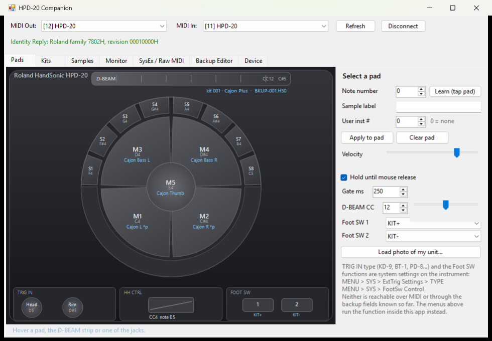
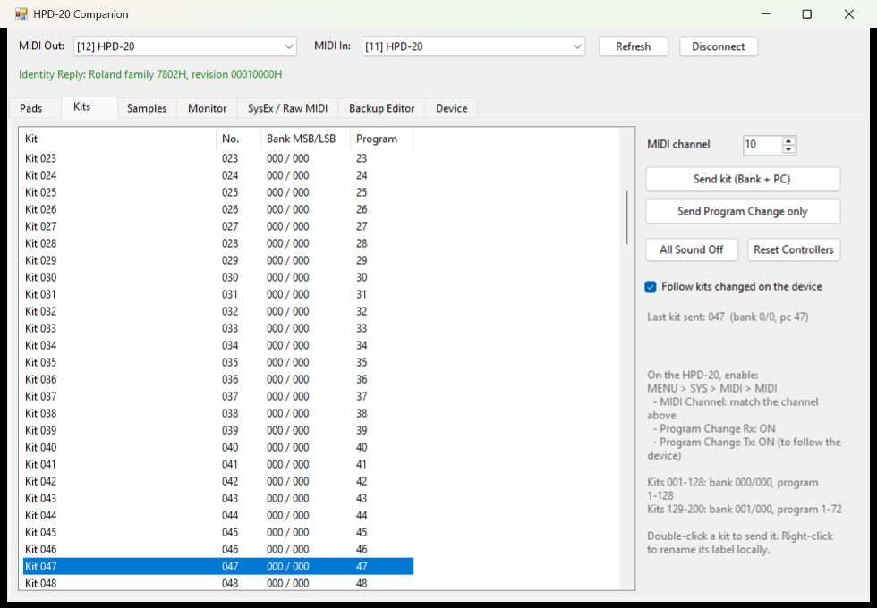
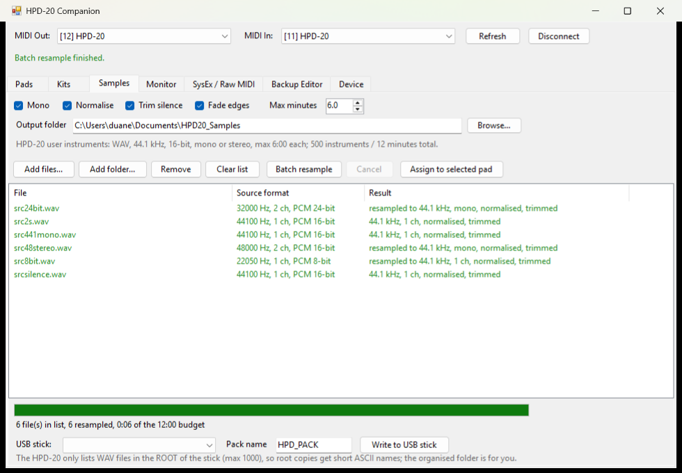
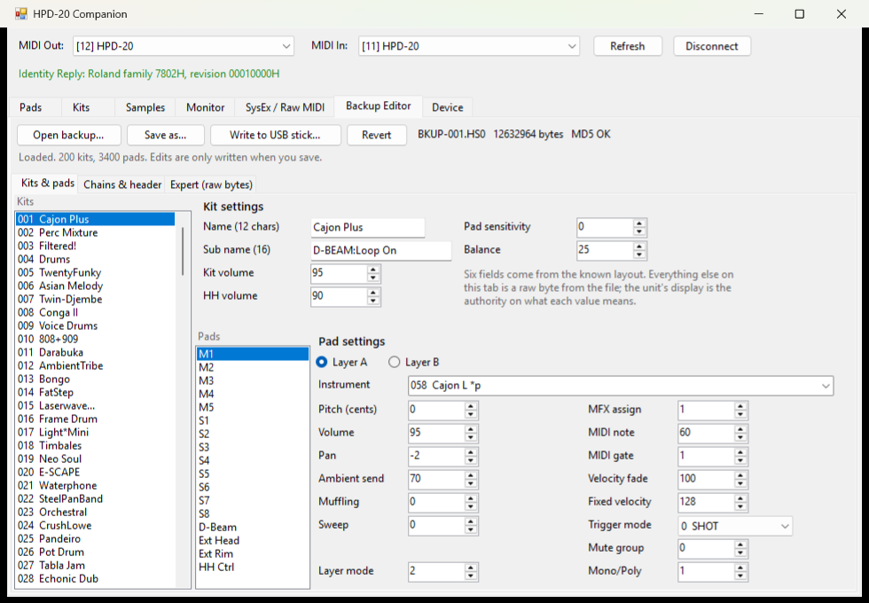
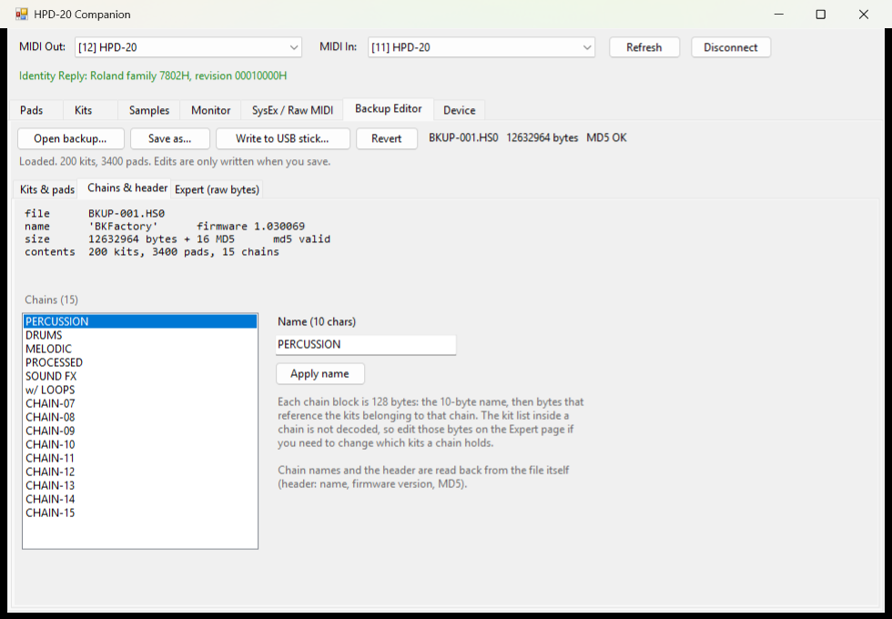
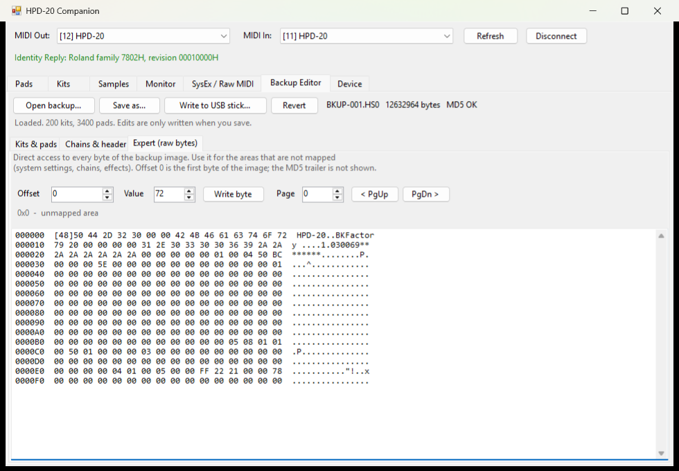

# Using HPD-20 Companion

Everything the app does, screen by screen, plus the settings the instrument itself needs.

- [Before you start](#before-you-start)
- [Connecting](#connecting)
- [Pads tab](#pads-tab)
- [Kits tab](#kits-tab)
- [Samples tab](#samples-tab)
- [Backup Editor](#backup-editor)
- [Monitor, SysEx, Device](#monitor-sysex-device)
- [Command line](#command-line)
- [Troubleshooting](#troubleshooting)

---

## Before you start

You need the **Roland USB driver** for the HPD-20 installed, and the unit connected by USB. The app
talks to it as an ordinary Windows MIDI device — no special driver of its own.

On the instrument, press `MENU → SYS → MIDI → MIDI` and check:

| Setting | Value | Why |
|---|---|---|
| MIDI Channel | same as the app (default 1) | everything is sent on this channel |
| Program Change Rx | ON | lets the app change kits |
| Program Change Tx | ON | lets the app follow kit changes you make on the unit |
| Control Change Rx | ON | needed for D-BEAM and the controller sliders |

For each pad you want to trigger, `MENU → KIT → MIDI → NOTE` sets its note number. The factory values
(M1=60 … S8=72, D-BEAM=73, Ext Head=74, Ext Rim=75, HH=76) are already the app's defaults, so a
factory-fresh unit works immediately.

---

## Connecting

1. Start `HPD20Companion.exe`.
2. Choose **MIDI Out** and **MIDI In**. Ports whose name contains `HPD` or `HANDSONIC` are selected
   automatically; press **Refresh** after plugging the unit in.
3. Press **Connect**. The app immediately sends an Identity Request, and the Device tab fills in the
   reply (family code, firmware revision). If you see that, both directions work.

The status line under the buttons reports what happened. `Connect` turns into `Disconnect`; the app
also disconnects cleanly when you close it.

---

## Pads tab



The drawing is live. Click a pad to send its note; the pad flashes when the same note arrives from
the instrument, so you can see what the unit is doing while you play.

| Area | What it does |
|---|---|
| **M1–M5, S1–S8** | main and sub pads. Click to play, hold to sustain (or release after the *Gate ms* value when *Hold until mouse release* is off) |
| **D-BEAM** (strip across the top) | sends the CC configured at `MENU → SYS → MIDI → MIDI` (EFFECT1 = 12, EFFECT2 = 13); the *D-BEAM CC* box picks which |
| **TRIG IN — Head / Rim** | notes 74/75, i.e. what a pad plugged into TRIG IN plays |
| **HH CTRL** | note 76 and **CC4**, the hi-hat control pedal |
| **FOOT SW 1 / 2** | run a foot-switch *function* in the app (see below) |

Each tile carries the current assignment: the MIDI note for every pad, the controller number where the
element has one (D-BEAM shows its CC, HH CTRL shows CC4), and the foot-switch function. **When a backup
is loaded**, the notes and the instrument names come from that backup's selected kit, and a caption
under the D-BEAM strip names the kit and file being mirrored. Hovering any element describes it on the
line below the surface.

**Editing a pad.** Click it, then use the right-hand panel:

- **Note number** — the note that pad sends. **Learn** waits for you to strike that pad on the unit
  and records it, which is the fastest way to map a kit that uses non-factory notes.
- **Sample label / User inst #** — a local note of what you have loaded there. The HPD-20 cannot
  report pad assignments over MIDI, so this is your own bookkeeping, stored in
  `%APPDATA%\HPD20Ctrl\pads.ini`.
- **Apply to pad / Clear pad** — commit or erase that bookkeeping.

**Velocity** sets the note-on velocity used when you click. **Gate ms** sets the note length when
*Hold until mouse release* is off.

**Foot switches.** A foot switch does not send a note; it runs a function. The two dropdowns mirror
the instrument's list — OFF, KIT+, KIT−, D-BEAM SW, RT MODIFY PITCH SW, RT MODIFY EFFECT SW, ROLL SW,
ALL SOUND OFF. Clicking the switch button in the app runs that function *in the app*:

- **KIT+ / KIT−** sends the next or previous kit as bank select + program change.
- **ALL SOUND OFF** sends CC120.
- **D-BEAM SW / RT MODIFY / ROLL** are internal instrument states with no MIDI message, so the app
  only tells you what the unit would do.

The unit's own assignment still comes from its menu — see [Settings that only exist on the
instrument](#settings-that-only-exist-on-the-instrument).

**Load photo of my unit** puts a photo of your own HPD-20 behind the overlay if you would rather see
the real thing behind the pads.

---

## Kits tab



All 200 kits, with the mapping the MIDI implementation specifies:

| Bank MSB / LSB | Program | Kit |
|---|---|---|
| `000 / 000` | 1–128 | 001–128 |
| `001 / 000` | 1–72 | 129–200 |

- Double-click a kit, or **Send kit**, to change the unit.
- **Follow kits changed on the device** highlights the kit you select on the instrument (needs
  Program Change Tx = ON).
- Right-click a kit to give it a local label, because the HPD-20 does not transmit kit names over
  MIDI. Labels live in `%APPDATA%\HPD20Ctrl\labels.txt`.
- **All Sound Off** / **Reset Controllers** send CC120 / CC121 on the selected channel.

---

## Samples tab



The HPD-20 imports only WAV files that meet its specification — all of it from the owner's manual,
p. 34:

| | Requirement |
|---|---|
| Format | WAV / PCM |
| Sample rate | 44.1 kHz |
| Bit depth | 16-bit |
| Channels | mono or stereo |
| Length | 6:00 maximum per file |
| Capacity | 500 user instruments, 12:00 total |

**Resampling.** Add files or a whole folder, set the options, press **Batch resample**:

- **Mono** downmixes stereo material (halves the memory it uses on the unit).
- **Normalise** raises the peak to just under full scale.
- **Trim silence** removes leading/trailing silence and keeps 10 ms around the sound.
- **Fade edges** applies 5 ms fades so truncated samples do not click.
- **Max minutes** truncates over-long files instead of letting the unit reject them.

Rate conversion is a 24-tap windowed-sinc resampler; a file already at 44.1 kHz is only converted to
16-bit. The status line tracks how much of the 12-minute budget you have used.

**Writing the stick.** The instrument lists only WAVs in the **root** of the drive, so folders are
invisible to it. The writer therefore does both:

```
E:\
  001_Kick.WAV            <- short, pure-ASCII names: what the instrument lists
  002_Snare (tight).WAV
  HPD20_Samples\
    HPD_PACK\             <- organised copy for you, plus index.csv and READ-ME.txt
      Kick.wav
      Snare (tight).wav
```

Pick the drive, name the pack, press **Write to USB stick**. Numbering continues across packs, and
re-exporting the same pack reuses its names instead of duplicating them. Nothing the writer did not
create is ever deleted.

Then on the instrument: `MENU → USER INST → IMPORT`, pick a file, choose a user-instrument number,
and assign it to a pad with `MENU → KIT → INST`.

---

## Backup Editor



This is the only way to change what the instrument will not accept over MIDI: kit names, per-pad
instruments, levels, tuning, chains.

**The round trip**

1. On the unit: `MENU → SYS → USB Memory → Save Backup` (choose whether to include user instruments).
2. Copy `Roland/HPD-20/Backup/BKUP-nnn.HS0` to the PC if you like, and open it here.
3. Edit.
4. **Write to USB stick** — the app writes to `Roland/HPD-20/Backup` on the chosen drive and picks the
   next free `BKUP-nnn` number, so an existing backup is never overwritten.
5. On the unit: `MENU → SYS → USB Memory → Load Backup`.

> **Loading a backup erases every setting on the instrument.** Keep the original until an edited file
> has loaded successfully.

**Kits & pads.** Choose a kit on the left, then the pad and layer on the right.

- Kit level: name (12 characters), sub name (16), kit volume, hi-hat volume, pad sensitivity,
  balance.
- Per layer (A/B radios): instrument (850 names), pitch in cents, volume, pan, ambient send,
  muffling, sweep, MFX assign.
- Per pad: MIDI note, MIDI gate, velocity fade, fixed velocity, trigger mode, mute group, mono/poly,
  layer mode.

Numeric controls span the full stored range, so opening a file and saving it without editing cannot
change a stored value. The pad's 68 raw bytes are shown underneath for reference.

**Chains & header.** The header name, firmware version, size and MD5 state are shown read-only. The
15 chains can be renamed here (10 characters each); the kit-membership bytes are on the Expert page.



**Expert (raw bytes).** Pick an offset, read the dump, write a byte. The app names the region the
offset falls in — kit N, pad X of kit N, chain block, or unmapped. This reaches the areas that are not
decoded, such as system settings and effects.



**On saving.** The last 16 bytes of a backup are an MD5 of everything before them; the app recomputes
that on every save. Files whose MD5 does not match are flagged, and files that are too small are
refused.

---

## Monitor, SysEx, Device

**Monitor** shows every incoming byte with a timestamp, decoded and/or in hex. *Pause* freezes the
view, *Save log* writes it to a text file. Incoming notes light up the matching pad on the Pads tab.

**SysEx / Raw MIDI** sends arbitrary bytes. SysEx framing is completed automatically and an optional
Roland checksum is inserted before `F7`. *Identity Request* asks the unit who it is; *Load .syx* and
*Save last SysEx* handle files.

**Device** shows the parsed Identity Reply: manufacturer, device ID, family code, member code and
firmware revision.

---

## Settings that only exist on the instrument

Two settings have no MIDI message and no identified backup field, so they must be made on the unit:

| Setting | Where |
|---|---|
| TRIG IN pad type — KD-7, KD-9, BT-1, PD-8, PDX-6, PDX-8, CY-5, CY-8, CY-12C | `MENU → SYS → ExtTrig Settings → TYPE` |
| Foot switch 1/2 function | `MENU → SYS → FootSw Control` |

The TRIG IN type must match the pad you plug in, or it will trigger wrongly. The app mirrors the
foot-switch function list so you can run the MIDI-addressable ones, but the instrument's own
assignment still has to be set in its menu.

---

## Command line

| Argument | Purpose |
|---|---|
| *(none)* | normal start |
| `--demo 0` … `--demo 8` | start on a tab, connected to the instrument (or a loopback port), with demo data |
| `--hwtest <file> [port-match]` | run against a connected unit: identity, note, kit change, teardown |
| `--backupdiff <a> <b> [report]` | report what changed between two backup images |
| `--padtest <file>` | pad placement, jacks and hit-testing |
| `--selftest <file>` | kit mapping, checksum, port enumeration, SysEx round trip |
| `--uitest <file>` | connect → send kit → receive → disconnect through the UI |
| `--audiotest <file>` | WAV decoding and resampling |
| `--usbtest <file>` | USB export layout and naming |
| `--backuptest <file>` | backup structure, fields, MD5, corruption handling |
| `--backupcheck <backup> [report]` | validate a real backup file and round-trip it |

Test modes need no hardware — they use any `LOOPBACK` MIDI port the system provides, and skip the
round trip if there is none.

---

## Troubleshooting

**No MIDI ports listed.** The Roland driver is not installed, or the unit is in a mode that does not
expose MIDI. Install the driver, replug, press *Refresh*.

**Connect succeeds but nothing happens on the unit.** Channel mismatch, or `Program Change Rx` is off
(`MENU → SYS → MIDI → MIDI`).

**Clicking a pad does nothing.** That pad has no note in the app: use **Learn**, or check the kit's
`Note#`. The status bar says which pad is missing a note.

**The unit does not list the WAVs on the stick.** They must be in the root, named with plain ASCII,
and be 44.1 kHz / 16-bit. Use the Samples tab's writer rather than copying files into folders.

**The unit does not list the backup.** The file must sit in `Roland/HPD-20/Backup` and keep the
`BKUP-nnn.HS0` naming the instrument uses.

**Backup opens with an MD5 mismatch.** The file was modified or truncated by something else. The app
will still show it, but do not load it into the instrument.
